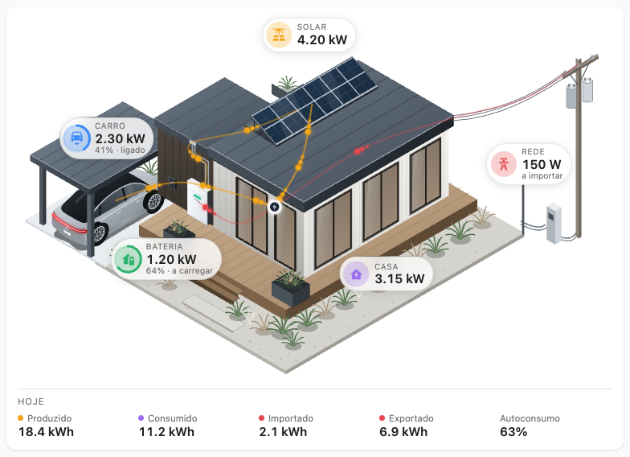

# Energy House Card

A Home Assistant card that shows your home's energy on an isometric house, with animated flows between solar panels, home battery, house, electric car and grid.



**[Try the demo →](https://dresende.github.io/energy-house-card/)** (simulated data, no Home Assistant needed)

> 🇵🇹 [Em português](#português)

## Install

### HACS

1. In **HACS → ⋮ → Custom repositories**, add `https://github.com/dresende/energy-house-card` with type **Dashboard**.
2. Search for "Energy House Card" in HACS and install it.
3. Reload the browser and add the card to a dashboard.

### Manual

1. Copy `energy-house-card.js` to `/config/www/`.
2. In **Settings → Dashboards → ⋮ → Resources**, add `/local/energy-house-card.js` as a **JavaScript module**.
3. Reload the browser and add the card to a dashboard.

## Visual editor

In **Edit dashboard → Add card**, search for "Energy House Card". The card comes pre-filled with your sensors when their names give them away (solar/pv/inverter, grid, battery, car/ev/wallbox, home/house/load). Each field only lists sensors of the right kind: power for the watts, battery for the SOCs and energy for today's totals. In the editor you can also:

- rename each block (Solar, Home, Grid, Battery, Car);
- pick the colours of the walls, deck and car;
- flip the sign of the grid or battery;
- set the height, fill the screen and choose the language.

Value and flow positions (`places`, `flows`) stay in YAML, generated by the positioning mode.

## Language

The card follows Home Assistant's language. It ships with English and Portuguese; any other language falls back to English. To force one, set `language: en` or `language: pt`. To use your own words for the blocks, set `names`:

```yaml
names:
  solar: Panels
  home: House
  grid: Utility
  battery: Powerwall
  car: EQS
```

## YAML

```yaml
type: custom:energy-house-card
entities:
  solar_power: sensor.solar_power          # W or kW
  home_power: sensor.home_power            # total consumption (includes the car)
  grid_power: sensor.grid_power            # + import, − export
  battery_power: sensor.battery_power      # + discharging, − charging
  battery_soc: sensor.battery_soc
  car_power: sensor.car_charger_power
  car_soc: sensor.car_battery_level
  car_plugged: binary_sensor.car_plugged   # optional
  # today's totals (optional, shown in the footer)
  solar_energy_today: sensor.solar_energy_today
  home_energy_today: sensor.home_energy_today
  grid_import_today: sensor.grid_import_today
  grid_export_today: sensor.grid_export_today
  car_energy_today: sensor.car_energy_today
```

If your grid or battery uses the opposite sign, add `invert_grid: true` or `invert_battery: true`. Without `home_power`, consumption is calculated from solar + battery + grid.

The car has its own block, so the Home block shows the house without the car: `home_power − car_power`. If your home sensor already leaves the car out (for example, the charger is on a separately metered circuit), add `home_includes_car: false`.

## Options

| Option | Default | What it does |
|---|---|---|
| `language` | Home Assistant's | `en` or `pt` |
| `names` | per language | Names of the blocks: `solar`, `home`, `grid`, `battery`, `car` |
| `full_screen` | `false` | The card takes the screen height (best in a **Panel** view) |
| `height` | — | Fixed height, e.g. `600px` or `80vh`; the house grows to fit |
| `colors` | white walls | House colours: `walls`, `deck` and `car`, in hex, e.g. `colors: { walls: "#3b4148", car: "#1f3a6b" }`. Each face's shading is derived from the colour you pick |
| `show` | from the entities | Parts of the drawing: `solar`, `battery`, `car`, `grid`, `vegetation` (e.g. `show: { vegetation: false }`) |
| `home_includes_car` | `true` | `home_power` includes the car's charging, so it is taken off the Home value. Set `false` if your sensor already leaves the car out |
| `static_flows` | `false` | For less capable devices (wall tablets, old phones): flows are drawn in their colours and direction, without animation, glow or blur. Also applies automatically when the device asks for reduced motion |
| `flow_threshold` | `10` | Below this many watts a flow stays still |
| `edit_positions` | `false` | Turns on positioning mode (see below) |
| `places` | 5 places | List of values over the picture |
| `flows` | the house paths | Points of each flow, in % of the picture |

## How flows are drawn

Solar feeds the battery first when it is charging, then the house, and the rest goes to the grid. The house → battery path only lights up when the sun can't cover the charge, for example when charging from the grid at night. The car's flow takes the colour of the main source at that moment.

## Full screen

Create a new view of type **Panel (1 card)** and use:

```yaml
type: custom:energy-house-card
full_screen: true
entities: ...
```

The house is vector art, so it stays sharp at any size, and the values and flows scale with it.

## Placing the values

1. Add `edit_positions: true` to the card.
2. Drag the values and the blue flow points where you want them.
3. Press **Copy YAML**, paste the `places:` / `flows:` block into the configuration and remove `edit_positions`.

You can add places for any sensor:

```yaml
places:
  - name: Living room
    entity: sensor.living_room_temperature
    icon: mdi:thermometer
    decimals: 1
    color: "#e5735a"
    x: 76
    y: 52
```

A place with a `role` (`solar`, `home`, `grid`, `battery`, `car`) replaces that role's default place and drives the flows.

## No car, no battery, no panels

The house is drawn in SVG inside the card, so each part only shows when it makes sense:
- Without `car_power`, the car, carport, wallbox, car value and house → car flow disappear.
- Without `battery_power`, the battery disappears.
- Without `solar_power`, the panels disappear.
- Without `grid_power`, the pole and cables disappear.

To force it, use `show`:

```yaml
show:
  car: false        # hide the car even with entities set
  vegetation: false # house without a garden
```

## Development

```
src/card.js                 card code (the house goes where "__HOUSE_SVG__" is)
src/house.svg               the house drawing
tools/house-generator.html  house generator, with the parts in groups (#solar, #battery, #ev, #grid…)
tools/extract_svg.py        generator → src/house.svg
tools/car.py                draws the car into the generator
tools/build.py              src/ → energy-house-card.js
```

After changing the house in the generator:

```bash
python3 tools/extract_svg.py && python3 tools/build.py
```

After changing only the code, `python3 tools/build.py` is enough. The built `energy-house-card.js` is committed, because it is the file HACS installs.

To see the card without Home Assistant, run `python3 -m http.server` in the folder and open `http://localhost:8000/preview.html`. The preview has simulated data, light/dark theme, Portuguese, full screen, positioning mode, and scenarios without a car and without a battery.

## Português

Card para o Home Assistant com uma casa isométrica e os fluxos de energia animados entre painéis solares, bateria, casa, carro e rede. O card segue a língua do Home Assistant: em português, todos os textos (card e editor visual) aparecem em português. Para forçar, usa `language: pt`.

- **Instalar:** em HACS → ⋮ → Repositórios personalizados, adiciona `https://github.com/dresende/energy-house-card` com o tipo **Dashboard**.
- **Configurar:** pelo editor visual, que pré-preenche os sensores.
- **Mudar os nomes dos blocos:** no grupo "Nomes" do editor, ou com `names:` no YAML.

As restantes opções estão descritas acima.
